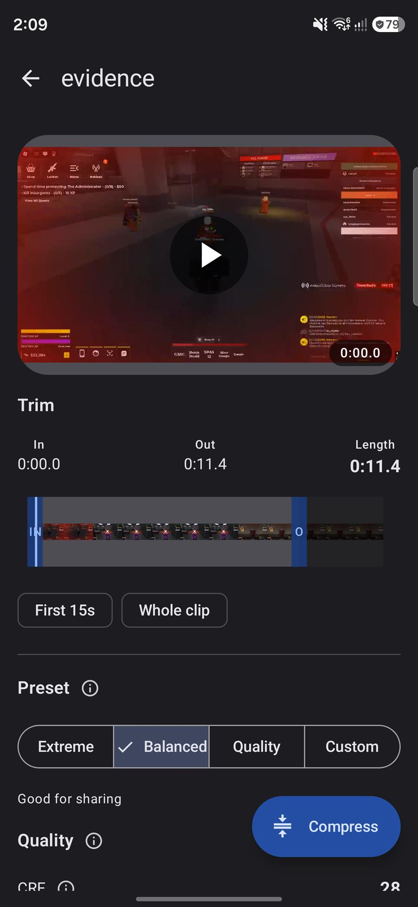
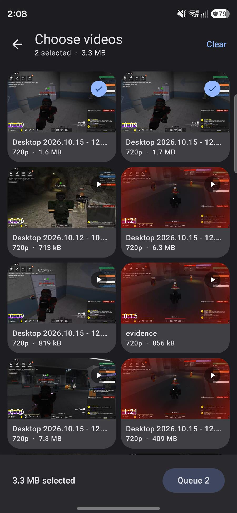
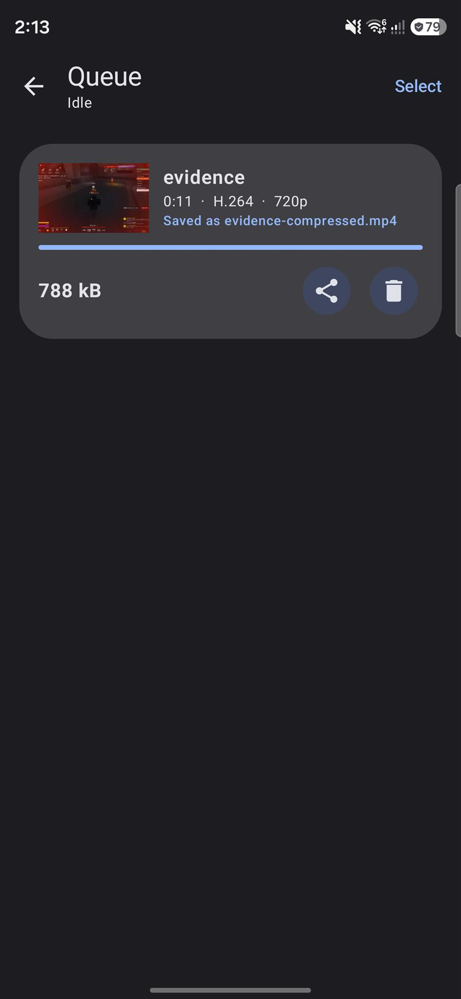
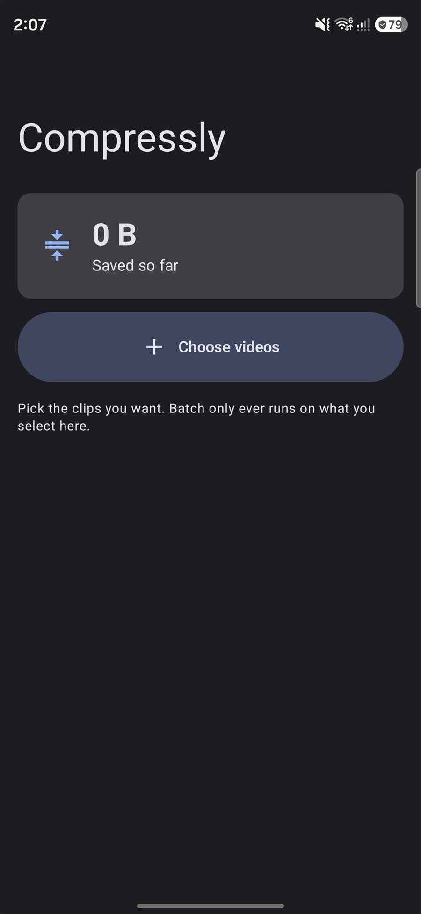
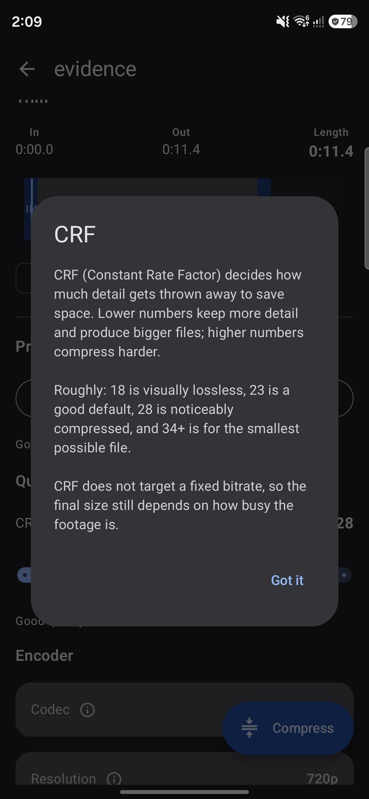

<div align="center">

# Compressly

**Cut and shrink videos on your phone — powered by FFmpeg, designed with Material 3 Expressive.**

[](LICENSE)
[](https://kotlinlang.org)
[](https://developer.android.com/build)


</div>

---

## What it does

Compressly re-encodes video with **x264 / x265** so you can fit a lot of footage into a lot
of space. It trims with a frame-accurate timeline, previews the result before you commit,
estimates the output size up front, and keeps working when you leave the app.

| Trim | Pick | Result |
|---|---|---|
|  |  |  |

<p align="center">
  
  
</p>

---

## Features

**Cutting**
- Filmstrip timeline with draggable **in / out** handles
- Frame-accurate trimming (`-ss` before `-i` decodes and discards, rather than snapping to keyframes)
- Preview playback that only plays the selected range and restarts from the top when it ends
- Quick chips for *First 15s* and *Whole clip*

**Compressing**
- Three presets — **Extreme**, **Balanced**, **Quality** — plus **Custom**
- Editing any setting by hand switches the preset to *Custom*, so you always know what you have
- CRF slider (16–38) with plain-language guidance next to it
- Resolution cap that never upscales, encoder speed, codec (H.264 / H.265 / MPEG-4), audio bitrate
- Output size estimated *before* you encode, and a warning when the settings would make the file bigger

**Batch & queue**
- Multi-select in the picker with a live count and total size
- Sequential background queue with live progress, speed and ETA
- Foreground service + notification, so compression survives backgrounding
- Cancel the current job or the whole batch from the notification
- Multi-select delete that reports how much space it frees

**Output**
- Editable filename, sanitised and forced to `.mp4`
- Saved to `Movies/Compressly` via MediaStore, visible in the gallery immediately
- Share sheet, or delete

**Explainability**
- Inline `ⓘ` help for CRF, resolution, speed, codec, audio and the size estimate
- Material 3 Expressive: dynamic colour on Android 12+, expressive motion scheme, expressive components

---

## Building from source

Requires **JDK 17+** and the **Android SDK** (compileSdk 37).

```bash
git clone https://github.com/arbuz181pl/Compressly.git
cd Compressly

# Point the build at your SDK
echo "sdk.dir=$ANDROID_HOME" > local.properties

./gradlew assembleDebug        # debug APK
./gradlew bundleRelease        # Play Store App Bundle
./gradlew testDebugUnitTest    # unit tests
```

Then `adb install -r app/build/outputs/apk/debug/app-debug.apk`.

The release build is R8-minified and split by ABI, which cuts the download from ~78 MB
(the universal APK) to **~35 MB** for a single device — the FFmpeg native libraries dominate
the size either way.

---

## How it works

```
UI (Compose, Material 3 Expressive)
  └── CompresslyViewModel ──── JobRepository (StateFlow, process-wide)
                                  │
                          CompressionService (foreground, mediaProcessing)
                            │  1. stage input → cache   (FFmpeg needs a seekable file)
                            │  2. encode  → temp file
                            │  3. publish → MediaStore Movies/Compressly
                            └── FFmpegEngine ── FFmpegKit (executeWithArgumentsAsync)
```

A few decisions worth knowing about:

- **Inputs are staged into the cache first.** SAF pipes are seek-hostile, and accurate
  trimming needs seeking. Copying the source first costs disk I/O but makes `-ss` reliable.
- **Outputs are encoded to a temp file and only inserted into MediaStore once they succeed**,
  so a failed job never leaves a broken entry in the gallery.
- **Jobs run one at a time.** Parallel x264 encodes fight over the same cores and finish
  slower overall.
- **Arguments are passed as a `String[]`,** not a shell string, so paths with spaces or
  non-ASCII characters need no escaping.
- **Progress comes from FFmpegKit's statistics callback**, which reports the real output
  timestamp and encoding speed rather than being scraped out of the log.

### FFmpeg arguments

Built by `FFmpegArgs`, e.g. for a Balanced 720p job:

```
-hide_banner -nostdin -loglevel error -y
-ss <start> -i <input> -t <duration>
-map 0:v:0 -map 0:a:0?
-vf scale=-2:720
-c:v libx264 -preset veryfast -crf 28 -profile:v high -level 4.1 -pix_fmt yuv420p
-c:a aac -b:a 128k -ac 2 -ar 44100
-metadata:s:v:0 rotate=0 -movflags +faststart
<output>
```

---

## Tech stack

| | |
|---|---|
| Language | Kotlin 2.4 |
| UI | Jetpack Compose, Material 3 **1.5.0-beta01** (Expressive) |
| Media | FFmpegKit `8.1.9` (maintained community fork), Media3 ExoPlayer for preview |
| Background | Foreground service (`mediaProcessing`) + StateFlow queue |
| Storage | MediaStore, DataStore-free (settings live in the ViewModel) |
| Build | AGP 9.4.1, Gradle 9.8.1, version catalog |

### Why the FFmpegKit fork?

`com.arthenica:ffmpeg-kit-*` was **retired in April 2025**. It no longer targets current
Android SDKs and cannot meet Google's 16 KB memory page requirement, which has been mandatory
for Play Store updates since November 2025.

This project uses [`dev.ffmpegkit-maintained`](https://github.com/ffmpegkit-maintained/ffmpeg),
a community continuation that keeps the **same `com.arthenica.ffmpegkit` API** — only the
Gradle groupId changes.

---

## License

**GPL-3.0.**

This is not a free choice: the `ffmpeg-kit-full-gpl` artifact bundles **x264 and x265**, which
are GPL, and linking them makes the combined work GPL-3.0. The full text is in
[LICENSE](LICENSE).

If you need a more permissive license, swap the dependency in
[`libs.versions.toml`](gradle/libs.versions.toml):

```toml
- ffmpeg-kit-full-gpl = { module = "dev.ffmpegkit-maintained:ffmpeg-kit-full-gpl", version.ref = "ffmpegKit" }
+ ffmpeg-kit-full     = { module = "dev.ffmpegkit-maintained:ffmpeg-kit-full",     version.ref = "ffmpegKit" }
```

That build encodes through **MediaCodec hardware codecs** instead of x264/x265 and is
**LGPL-3.0** — smaller APK, faster on-device, but with fewer codec and tuning options.

---

## Credits

- [FFmpeg](https://ffmpeg.org) — the engine
- [ffmpeg-kit-maintained](https://github.com/ffmpegkit-maintained/ffmpeg) — Android bindings
- [Jetpack Media3](https://developer.android.com/media/media3) — preview playback
- [Material 3 Expressive](https://m3.material.io) — design system

Screenshots taken on a Galaxy S25 Ultra (Android 17).