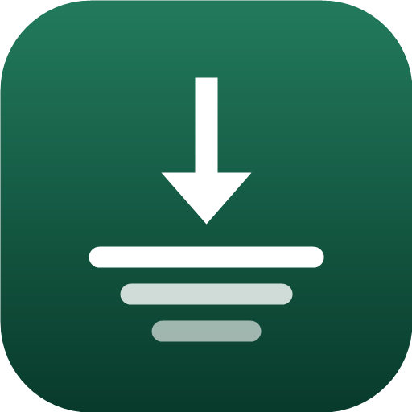

<div align="center">



# Compressly

### Cut and shrink videos on Android — FFmpeg under the hood, Material 3 Expressive on top

[](LICENSE)
[](https://kotlinlang.org)
[](https://developer.android.com/build)
[](https://ffmpeg.org)
[](https://developer.android.com/about/versions/8)
[](https://developer.android.com/about/versions/17)
[](https://m3.material.io)

<br>

**Made:** 17/10/2026
**Updated:** 17/10/2026
**Version:** v1.0.0
**License:** GPL-3.0

</div>

---

## Screenshots

<div align="center">

| Trim & preview | Pick & batch | Results |
|:-:|:-:|:-:|
|  |  |  |

</div>

<div align="center">

| Home | In-app help |
|:-:|:-:|
|  |  |

</div>

---

## What it does

Compressly re-encodes video with **x264 / x265** so a lot of footage fits into a lot of
space. Trim with a frame-accurate timeline, preview before committing, see the estimated
output size up front, and let it finish in the background.

> [!IMPORTANT]
> **Compressly only ever touches the clips you pick.** There is deliberately no
> "compress everything" shortcut — batch runs on your explicit selection, and the bar always
> tells you how many clips and how much data you have queued.

---

## Features

### ✂️ Cutting

- Filmstrip timeline with draggable **in / out** handles
- Frame-accurate trimming — `-ss` is placed before `-i` so FFmpeg decodes and discards,
  instead of snapping to the nearest keyframe
- Preview playback that only plays the selected range, and rewinds to the in-point when it ends
- Quick chips for *First 15s* and *Whole clip*

### 🎚️ Compressing

- Three presets — **Extreme**, **Balanced**, **Quality** — plus **Custom**
- Touch any setting by hand and the preset switches to **Custom**, so you always know exactly
  what you are about to encode
- CRF slider (16–38) with a plain-language hint beside it
- Resolution cap that **never upscales**, encoder speed, codec (H.264 / H.265 / MPEG-4), audio bitrate
- Output size **estimated before** you encode — and a warning when your settings would make
  the file *bigger* instead of smaller

### 📦 Batch & queue

- Multi-select in the picker with a live clip count and total size
- Sequential background queue with progress, encoding speed and ETA
- Foreground service + notification, so compression survives leaving the app
- Cancel the current job or the entire batch straight from the notification
- Multi-select delete that tells you how much space it frees

### 💾 Output

- Editable filename, sanitised and forced to `.mp4`
- Written to `Movies/Compressly` through MediaStore, so it appears in the gallery immediately
- Share sheet, or delete

### 💡 Explainability

- Inline `ⓘ` explanations for CRF, resolution, speed, codec, audio and the size estimate
- Material 3 Expressive: dynamic colour on Android 12+, expressive motion scheme, expressive components

---

## Quick start

```bash
git clone https://github.com/arbuz181pl/Compressly.git
cd Compressly

# Point the build at your SDK
echo "sdk.dir=$ANDROID_HOME" > local.properties

./gradlew installDebug          # build + install on a connected device
./gradlew bundleRelease         # Play Store App Bundle
./gradlew testDebugUnitTest     # unit tests
```

**Requirements:** JDK 17+ and the Android SDK with **compileSdk 37**.

The release build is R8-minified and split by ABI, which takes the download from **~78 MB**
(the universal APK) down to **~35 MB** for a single device — the FFmpeg native libraries
dominate the size either way.

> [!NOTE]
> `local.properties` holds your local SDK path and is intentionally **not** committed.
> Android Studio generates it for you when you open the project.

---

## Continuous integration

Two workflows, both under `.github/workflows/`:

### `Verify build` — automatic

Runs on every push to `main` and on every pull request. It compiles the debug **and** release
variants, runs the unit tests, and fails on lint errors.

It never signs anything, but it **does** attach the APKs to a rolling GitHub release tagged
`ci-<commit>`, so a downloadable debug and unsigned-release APK exists for every commit
without anyone building locally.

> [!NOTE]
> Both workflows use the Android SDK that GitHub's runners already provide rather than
> `android-actions/setup-android`. That action was failing on the current runner image, and
> removing it also removes a dependency that changes without notice. AGP downloads the
> missing platform and build-tools revisions itself.

### `Build & release` — manual

**Actions -> Build & release -> Run workflow**, then type a version:

```
version_name : 1.0.1        <- required
version_code :              <- optional, derived if left blank
prerelease  : false         <- optional
```

It builds a **signed** APK and an App Bundle, stamps them with the version you typed
(`Compressly-1.0.1.apk`), verifies the APK really reports that version, and attaches both to a
GitHub release tagged `v1.0.1`.

`versionCode` must increase with every Play upload, so if you leave the field blank it is
derived from the version:

| You type | versionCode |
|---|---|
| `1.0.1` | `1000001` |
| `1.2.3` | `1002003` |
| `2.0.0` | `2000000` |

Pre-release versions like `1.0.1-beta` are accepted and derive from `1.0.1`.

> [!WARNING]
> The release workflow needs four repository secrets before it will run
> (`ANDROID_KEYSTORE_BASE64`, `KEYSTORE_PASSWORD`, `KEY_ALIAS`, `KEY_PASSWORD`).
> **Follow [`scripts/README.md`](scripts/README.md) to create them** — and back up the
> keystore, because losing it means you can never update the listing on Play.

---

## How it works

```
UI (Compose · Material 3 Expressive)
  └── CompresslyViewModel ──── JobRepository  (StateFlow, process-wide)
                                 │
                        CompressionService  (foreground · mediaProcessing)
                          1. stage input → cache      FFmpeg needs a seekable file
                          2. encode    → temp file
                          3. publish   → MediaStore · Movies/Compressly
                          └── FFmpegEngine ── FFmpegKit.executeWithArgumentsAsync
```

Decisions worth knowing about:

- **Sources are staged into the cache first.** SAF pipes are seek-hostile and accurate
  trimming needs seeking, so the extra copy buys reliable `-ss`.
- **Output goes to a temp file and is only inserted into MediaStore on success**, so a failed
  job never leaves a broken entry in the gallery.
- **Jobs run one at a time** — parallel x264 encodes fight over the same cores and finish
  slower overall.
- **Arguments are passed as a `String[]`,** not a shell string, so paths containing spaces
  or non-ASCII characters need no escaping.
- **Progress comes from FFmpegKit's statistics callback**, which reports the real output
  timestamp and encoding speed rather than being scraped out of the log.
- **Size estimates use a bits-per-pixel model** anchored on x264 measurements, so they track
  reality closely without encoding anything first.

### The FFmpeg command

Built by `FFmpegArgs`. A Balanced 720p job looks like this:

```bash
ffmpeg -hide_banner -nostdin -loglevel error -y \
  -ss <start> -i <input> -t <duration> \
  -map 0:v:0 -map 0:a:0? \
  -vf scale=-2:720 \
  -c:v libx264 -preset veryfast -crf 28 -profile:v high -level 4.1 -pix_fmt yuv420p \
  -c:a aac -b:a 128k -ac 2 -ar 44100 \
  -metadata:s:v:0 rotate=0 -movflags +faststart \
  <output>
```

---

## Tech stack

| Layer | Choice |
|---|---|
| Language | Kotlin 2.4 |
| UI | Jetpack Compose · Material 3 `1.5.0-beta01` (Expressive) |
| Video engine | FFmpegKit `8.1.9` — community maintained fork |
| Preview | Media3 ExoPlayer |
| Background | Foreground service (`mediaProcessing`) + StateFlow queue |
| Storage | MediaStore |
| Build | AGP 9.4.1 · Gradle 9.8.1 · version catalog |

### Why a fork of FFmpegKit?

`com.arthenica:ffmpeg-kit-*` was **retired in April 2025**. It no longer targets current
Android SDKs and cannot satisfy Google's **16 KB memory page** requirement, mandatory for Play
Store updates since November 2025.

This project uses [`dev.ffmpegkit-maintained`](https://github.com/ffmpegkit-maintained/ffmpeg),
a community continuation that keeps the **exact same `com.arthenica.ffmpegkit` API** — only
the Gradle `groupId` changes.

---

## License

<div align="center">

**GPL-3.0** — see [LICENSE](LICENSE)

</div>

> [!WARNING]
> This is not a free choice. The `ffmpeg-kit-full-gpl` artifact bundles **x264 and x265**,
> which are GPL, and linking against them makes the combined work **GPL-3.0**.

Want a more permissive licence? Swap one line in
[`gradle/libs.versions.toml`](gradle/libs.versions.toml):

```diff
- ffmpeg-kit-full-gpl = { module = "dev.ffmpegkit-maintained:ffmpeg-kit-full-gpl", version.ref = "ffmpegKit" }
+ ffmpeg-kit-full     = { module = "dev.ffmpegkit-maintained:ffmpeg-kit-full",     version.ref = "ffmpegKit" }
```

That build encodes through **MediaCodec hardware codecs** instead of x264/x265 and is
**LGPL-3.0** — smaller APK and faster on device, with fewer codec and tuning options.

---

## Credits

- [**FFmpeg**](https://ffmpeg.org) — the engine
- [**ffmpeg-kit-maintained**](https://github.com/ffmpegkit-maintained/ffmpeg) — maintained Android bindings
- [**Jetpack Media3**](https://developer.android.com/media/media3) — preview playback
- [**Material 3 Expressive**](https://m3.material.io) — design system

---

<div align="center">

**Found a bug?** Open an issue.
**Like it?** Star it.

Made with ☕ by [arbuz181pl](https://github.com/arbuz181pl)

</div>